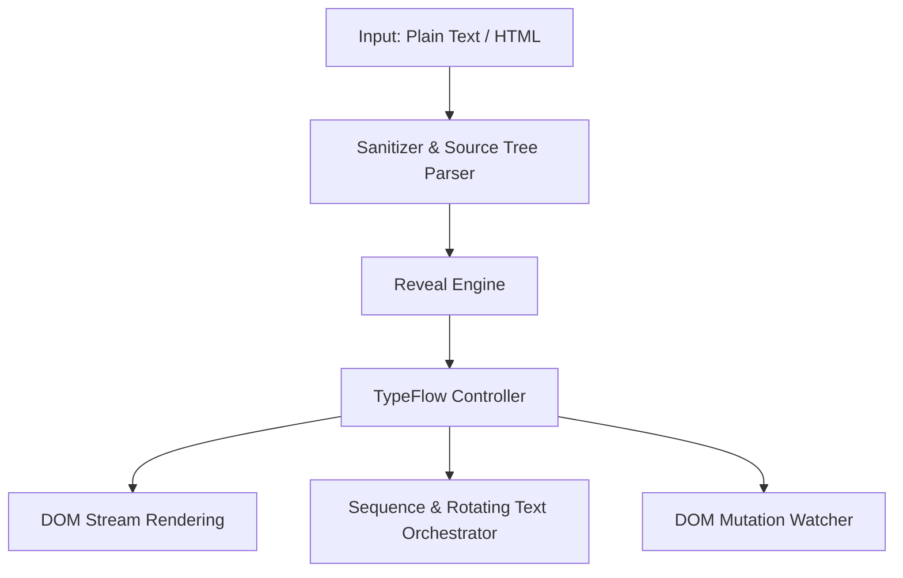

# TypeFlow

TypeFlow is a lightweight, interruptible, framework-agnostic typewriter animation library designed for modern web applications and static sites.

## Overview

TypeFlow delivers zero-dependency text animation with precise frame control, rich HTML tag preservation, automated sanitization, multi-style bidirectional erasing, sequential step orchestration, and framework adapters for React and Vue.



## Features

- **Zero Runtime Dependencies**: Pure ECMAScript with DOM integration.
- **Safe HTML Support**: Parses and types structured markup while keeping HTML tags balanced and sanitized against script injection.
- **Bidirectional Erasing**: Erase animations via `end` (backspace), `start` (left erosion), `fade` (opacity transition), or `instant`.
- **Sequence Orchestration**: Coordinate multi-step animations (`type`, `erase`, `pause`, `call`) across multiple DOM targets.
- **Rotator Pattern**: Built-in helper for cyclic word replacements with customizable hold and pause durations.
- **DOM Mutation Watcher**: Automatically animate elements injected into the DOM without manual `MutationObserver` code.
- **Reduced Motion Compliance**: Respects `prefers-reduced-motion` settings automatically.
- **Framework Adapters**: First-class adapters for React (`createTypeFlowReact`, `createTypeFlowSequenceReact`) and Vue (`createTypeFlowVue`, `createTypeFlowSequenceVue`).

## Installation

### NPM

```bash
npm install @staticcanvas/typeflow
```

### JSR

```bash
npx jsr add @staticcanvas/typeflow
```

### CDN

```html
<!-- UMD (Global window.TypeFlow) -->
<script src="https://cdn.jsdelivr.net/npm/@staticcanvas/typeflow@2.2.0/dist/typeflow.js"></script>

<!-- ESM Module -->
<script type="module">
  import { TypeFlow, seq } from 'https://cdn.jsdelivr.net/npm/@staticcanvas/typeflow@2.2.0/dist/typeflow.esm.js';
</script>
```

## Usage

### Basic Typing & Erasing

```javascript
import { TypeFlow } from '@staticcanvas/typeflow';

// Plain text typing
const controller = TypeFlow.type('#headline', 'Building resilient interfaces.', {
  speed: 45,
  cursor: '|',
  cursorBlink: true,
  onComplete: (text) => console.log('Typing complete:', text)
});

// Erase with left-erosion style
TypeFlow.erase('#headline', {
  speed: 20,
  eraseStyle: 'start'
});
```

### HTML Mode with Sanitization

```javascript
import { TypeFlow } from '@staticcanvas/typeflow';

TypeFlow.type('#output', 'Deploy to <strong>Production</strong> with <span class="badge">Zero Downtime</span>', {
  html: true,
  speed: 30,
  allowedTags: ['strong', 'span'],
  allowedAttributes: { span: ['class'] }
});
```

### Sequential Multi-Step Orchestration

```javascript
import { TypeFlow, seq } from '@staticcanvas/typeflow';

TypeFlow.sequence([
  seq.type('#step-1', 'Initializing runtime kernel...'),
  seq.pause(600),
  seq.call(() => console.log('Phase 1 complete')),
  seq.erase('#step-1', { eraseStyle: 'fade', duration: 300 }),
  seq.type('#step-2', 'All systems operational.')
], { repeat: 1 });
```

### Rotating Words

```javascript
import { TypeFlow } from '@staticcanvas/typeflow';

TypeFlow.rotate('#rotating-text', ['Fast.', 'Secure.', 'Accessible.'], {
  typeConfig: { speed: 40 },
  eraseConfig: { eraseStyle: 'end', speed: 20 },
  holdDuration: 1500,
  pauseBetween: 250,
  repeat: Infinity
});
```

### React Adapter

```javascript
import React from 'react';
import { createTypeFlowReact } from '@staticcanvas/typeflow';

const useTypeFlow = createTypeFlowReact(React);

function Headline() {
  const headlineRef = useTypeFlow('Welcome to StaticCanvas', { speed: 40 });
  return <h1 ref={headlineRef} />;
}
```

### Vue Adapter

```javascript
import * as Vue from 'vue';
import { createTypeFlowVue } from '@staticcanvas/typeflow';

const useTypeFlow = createTypeFlowVue(Vue);

export default {
  setup() {
    const text = Vue.ref('Reactive Typewriter');
    const containerRef = useTypeFlow(() => text.value, { speed: 50 });
    return { containerRef };
  },
  template: '<div ref="containerRef"></div>'
};
```

## API Reference

### `TypeFlowConfig`

| Property | Type | Default | Description |
| :--- | :--- | :--- | :--- |
| `speed` | `number` | `50` (type) / `25` (erase) | Milliseconds per character. |
| `delay` | `number` | `0` | Delay before animation starts in milliseconds. |
| `speedVariance` | `number` | `0` | Random variance range in milliseconds per character. |
| `cursor` | `string` | `"\|"` | Cursor character appended during animation. Set to `""` to disable. |
| `cursorBlink` | `boolean` | `true` | Enables post-completion cursor blinking. |
| `html` | `boolean` | `false` | Enables sanitized HTML parsing mode. |
| `mode` | `"replace" \| "append"` | `"replace"` | Clears target or appends to existing DOM child nodes. |
| `allowedTags` | `string[]` | Default allowlist | Array of permitted HTML tag names. |
| `allowedAttributes` | `Record<string, string[]>` | Default map | Map of allowed attributes per HTML tag. |
| `sanitizer` | `(html: string) => string` | `undefined` | Custom sanitizer function overriding default sanitizer. |
| `respectReducedMotion`| `boolean` | `true` | Instantly completes animation when reduced motion is preferred. |
| `ariaLive` | `"off" \| "polite" \| "assertive"` | `undefined` | ARIA live region policy applied to target element. |
| `eraseStyle` | `"end" \| "start" \| "instant" \| "fade"` | `"end"` | Erase technique direction or visual transition mode. |
| `duration` | `number` | `250` | Transition duration in ms when `eraseStyle: "fade"`. |
| `preserveBaseline` | `boolean` | `true` | Preserves base content when erasing `append` mode elements. |
| `onStart` | `() => void` | `undefined` | Callback invoked when animation begins. |
| `onComplete` | `(text: string) => void` | `undefined` | Callback invoked upon animation completion. |
| `onInterrupt` | `() => void` | `undefined` | Callback invoked when controller is aborted before completion. |

### `TypeFlowController`

| Method / Property | Type | Description |
| :--- | :--- | :--- |
| `stop()` | `() => void` | Immediately terminates the active animation without rejecting promises. |
| `promise` | `Promise<TypeFlowResult>` | Resolves with `{ completed: boolean, text: string }` upon completion or stop. |

### Core Engine Methods

| Method | Parameters | Returns | Description |
| :--- | :--- | :--- | :--- |
| `TypeFlow.type()` | `target, text, config?` | `TypeFlowController` | Types text or sanitized HTML into target element. |
| `TypeFlow.erase()` | `target, config?` | `TypeFlowController` | Erases content from target element. |
| `TypeFlow.sequence()` | `steps, seqConfig?` | `TypeFlowController` | Executes an array of animation steps sequentially. |
| `TypeFlow.rotate()` | `target, words, config?` | `TypeFlowController` | Cycles through an array of strings in a loop. |
| `TypeFlow.watch()` | `container, selector, cb` | `{ disconnect: () => void }` | Observes and animates dynamically added DOM nodes. |
| `TypeFlow.stop()` | `target` | `void` | Stops the active animation for a target. |
| `TypeFlow.stopAll()` | `none` | `void` | Stops all currently active TypeFlow instances. |
| `TypeFlow.isTyping()`| `target` | `boolean` | Returns active animation status for a target element. |

## License

MIT (c) Garvey K. Snow
