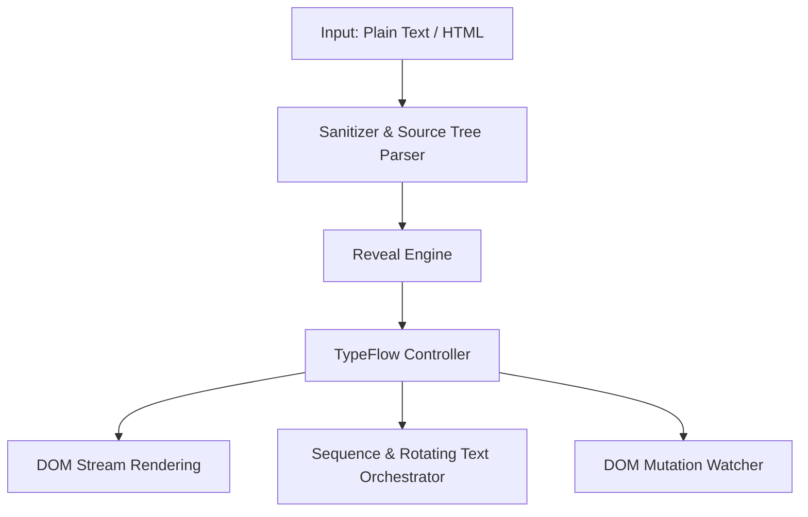

<div align="left">


[](https://gitlab.com/staticcanvas/typeflow)
[](https://gitlab.com/staticcanvas/typeflow/-/pipelines)
[](https://codecov.io/gl/staticcanvas/typeflow)
[](https://staticcanvas.gitlab.io/typeflow)
[](https://gitlab.com/staticcanvas/typeflow/-/work_items?sort=created_date&state=opened&first_page_size=20)

[](https://gitlab.com/staticcanvas/typeflow/-/releases/permalink/latest)
[](https://gitlab.com/staticcanvas/typeflow/-/tags)

[](https://www.npmjs.com/package/@staticcanvas/typeflow)
[](https://www.npmjs.com/package/@staticcanvas/typeflow)

[](https://jsr.io/%40staticcanvas/typeflow)
[](https://cdn.jsdelivr.net/package/npm/@staticcanvas/typeflow)

[](https://gitlab.com/api/v4/projects/staticcanvas%2Ftypeflow/jobs/artifacts/develop/raw/runtime-badge-flat.svg?job=generate-runtime-badge)

> **TypeFlow** is a lightweight, interruptible, framework-agnostic typewriter animation library designed for modern web applications and static sites.

</div>

## **Overview**

TypeFlow delivers zero-dependency text animation with precise frame control, rich HTML tag preservation, automated sanitization, multi-style bidirectional erasing, sequential step orchestration, and integrations for React, Vue, Svelte, Solid.js, Alpine.js, Astro, and Web Components.

<details>
<summary><strong>📚Table of Contents</strong></summary>

- [Overview](#overview)
- [Features](#features)
- [Arcutecture](#arcutecture)
- [Installation](#installation)
  - [NPM](#npm)
  - [JSR](#jsr)
  - [CDN](#cdn)
- [Usage](#usage)
  - [Basic Typing & Erasing](#basic-typing-erasing)
  - [Multi-Directional Typing & Scramble Charsets](#multi-directional-typing-scramble-charsets)
  - [Smart Morph Diffing](#smart-morph-diffing)
  - [Real-Time LLM Token Streaming](#real-time-llm-token-streaming)
  - [Animation Presets](#animation-presets)
  - [HTML Mode with Sanitization](#html-mode-with-sanitization)
  - [Sequential Multi-Step Orchestration & Viewport Triggers](#sequential-multi-step-orchestration-viewport-triggers)
  - [Framework Adapters](#framework-adapters)
    - [React](#react)
    - [Vue](#vue)
    - [Svelte](#svelte)
    - [Solid.js](#solidjs)
    - [Alpine.js](#alpinejs)
    - [Astro](#astro)
    - [Web Components](#web-components)
    - [Angular](#angular)
- [Companion Extensions](#companion-extensions)
- [API Reference](#api-reference)
  - [TypeFlowConfig](#typeflowconfig)
  - [TypeFlowController](#typeflowcontroller)
  - [Core Engine Methods](#core-engine-methods)
- [Development & NPM Scripts](#development-npm-scripts)
- [Extending TypeFlow & Developer Guide](#extending-typeflow-developer-guide)
  - [1. Custom Audio Synthesizers & Keystroke Callbacks](#1-custom-audio-synthesizers-keystroke-callbacks)
  - [2. Custom Scramble Charset & Character Pools](#2-custom-scramble-charset-character-pools)
  - [3. Writing Custom Sequence Step Helpers](#3-writing-custom-sequence-step-helpers)
  - [4. Creating Custom Framework Adapters](#4-creating-custom-framework-adapters)
- [Benchmarks](#benchmarks)
  - [Synthetic Benchmarks (Node.js & Modern V8 Engines)](#synthetic-benchmarks-nodejs-modern-v8-engines)
  - [License](#license)

</details>

## **Features**

- **Zero Runtime Dependencies**: Pure ECMAScript with native DOM batching.
- **Safe HTML Support**: Parses and types structured markup while keeping HTML tags balanced and sanitized against script injection.
- **`Intl.Segmenter` Powered**: Accurate grapheme and word segmentation for international character clusters and compound emojis (`🚀`, `👨‍👩‍👧‍👦`).
- **Multi-Directional Reveals & Erasing**: Type left-to-right, right-to-left, or expand center-outward (`direction: 'center'`). Erase via backspace (`end`), left erosion (`start`), inward shrink (`center`), opacity fade (`fade`), or matrix decrypt (`scramble`).
- **Scramble Charset Presets**: Built-in glyph presets (`matrix`, `blocks`, `ascii`, `ascii-extended`, `binary`, `hex`, `braille`, `runic`, `cyber`) and custom glyph overrides.
- **Procedural Web Audio Keystrokes**: Zero-asset procedural audio clicks, terminal pings, and cyber synth sounds (`audio: 'mechanical' | 'beep' | 'synth'`).
- **Smart Morph Diff Typing**: Computes longest common prefixes and only backspaces changed trailing characters (`TypeFlow.morph()`).
- **Real-Time Stream Ingestion**: Non-blocking FIFO token stream buffer for LLM / SSE token ingestion (`TypeFlow.stream()`).
- **Animation Presets**: One-line configuration profiles (`TypeFlow.preset('cyberpunk')`, `'terminal'`, `'writer'`, `'matrix'`, `'blocks'`, `'subtle'`).
- **CLS Layout Shift Prevention**: Automatic dimension stabilization (`TypeFlow.fit()`) preventing Cumulative Layout Shift during text rotations.
- **Natural Cadence Punctuation Pacing**: Micro-pauses at commas, colons, and sentence stops (`naturalCadence: true`).
- **Sequence Orchestration & Viewport Triggers**: Coordinate multi-step animations (`type`, `erase`, `pause`, `visible`, `call`) with `seq.visible()` IntersectionObserver delays.
- **Rotator Pattern & DOM Watcher**: Built-in helper for cyclic word replacements and automated mutation listeners.
- **Reduced Motion Compliance**: Respects `prefers-reduced-motion` settings automatically.
- **Framework Integrations**: First-class runtime adapters for React (`createTypeFlowReact`), Vue (`createTypeFlowVue`), Svelte (`createTypeFlowSvelte`), Solid.js (`createTypeFlowSolid`), and Alpine.js (`createTypeFlowAlpine`), plus native Web Components and framework-friendly Astro usage.

## **Arcutecture**



## **Installation**

### NPM

```bash
npm install @staticcanvas/typeflow
```

### JSR

```bash
npx jsr add @staticcanvas/typeflow
```

### CDN

```html
<!-- UMD (Global window.TypeFlow) -->
<script src="https://cdn.jsdelivr.net/npm/@staticcanvas/typeflow/dist/typeflow.js"></script>

<!-- ESM Module -->
<script type="module">
  import {
    TypeFlow,
    seq,
  } from 'https://cdn.jsdelivr.net/npm/@staticcanvas/typeflow/dist/typeflow.esm.js';
</script>
```

## **Usage**

### Basic Typing & Erasing

```javascript
import { TypeFlow } from '@staticcanvas/typeflow';

// Plain text typing with natural punctuation cadence and procedural audio
const controller = TypeFlow.type('#headline', 'Building resilient interfaces. Zero dependencies.', {
  speed: 45,
  naturalCadence: true,
  audio: 'mechanical',
  cursor: '|',
  cursorBlink: true,
  onComplete: (text) => console.log('Typing complete:', text),
});

// Erase inward toward center
TypeFlow.erase('#headline', {
  speed: 20,
  eraseStyle: 'center',
});
```

### Multi-Directional Typing & Scramble Charsets

```javascript
import { TypeFlow } from '@staticcanvas/typeflow';

// Expand outward from center with matrix scramble glyphs
TypeFlow.type('#terminal', 'SYSTEM SECURE: ACCESS GRANTED', {
  direction: 'center',
  typeStyle: 'scramble',
  scrambleCharset: 'matrix',
  scrambleRounds: 2,
  audio: 'synth',
  speed: 35,
});
```

### Smart Morph Diffing

```javascript
import { TypeFlow } from '@staticcanvas/typeflow';

// Automatically keeps "TypeFlow is " and only erases & replaces the trailing word
await TypeFlow.type('#headline', 'TypeFlow is fast');
await TypeFlow.morph('#headline', 'TypeFlow is lightweight');
```

### Real-Time LLM Token Streaming

```javascript
import { TypeFlow } from '@staticcanvas/typeflow';

const stream = TypeFlow.stream('#ai-response', { speed: 20, cursor: '|' });

// Push incoming SSE / WebSocket chunks seamlessly
sse.onmessage = (event) => {
  stream.push(event.data);
};
```

### Animation Presets

```javascript
import { TypeFlow } from '@staticcanvas/typeflow';

// Cyberpunk scramble decrypt preset
TypeFlow.type('#cyber', 'NEURAL LINK ESTABLISHED', TypeFlow.preset('cyberpunk'));

// Classic typewriter with human punctuation cadence
TypeFlow.type('#story', 'Chapter 1. It was a dark, stormy night...', TypeFlow.preset('writer'));
```

### HTML Mode with Sanitization

```javascript
import { TypeFlow } from '@staticcanvas/typeflow';

TypeFlow.type(
  '#output',
  'Deploy to <strong>Production</strong> with <span class="badge">Zero Downtime</span>',
  {
    html: true,
    speed: 30,
    allowedTags: ['strong', 'span'],
    allowedAttributes: { span: ['class'] },
  }
);
```

### Sequential Multi-Step Orchestration & Viewport Triggers

```javascript
import { TypeFlow, seq } from '@staticcanvas/typeflow';

TypeFlow.sequence(
  [
    seq.visible('#step-1'), // Waits until element scrolls into view
    seq.type('#step-1', 'Initializing runtime kernel...'),
    seq.pause(600),
    seq.call(() => console.log('Phase 1 complete')),
    seq.erase('#step-1', { eraseStyle: 'fade', duration: 300 }),
    seq.type('#step-2', 'All systems operational.'),
  ],
  { repeat: 1 }
);
```

### Framework Adapters

#### React

```jsx
import React from 'react';
import { createTypeFlowReact } from '@staticcanvas/typeflow';

const useTypeFlow = createTypeFlowReact(React);

function Headline() {
  const headlineRef = useTypeFlow('Welcome to StaticCanvas', { speed: 40 });
  return <h1 ref={headlineRef} />;
}
```

#### Vue

```vue
<script setup>
import * as Vue from 'vue';
import { createTypeFlowVue } from '@staticcanvas/typeflow';

const useTypeFlow = createTypeFlowVue(Vue);
const text = Vue.ref('Reactive Typewriter');
const headlineRef = useTypeFlow(() => text.value, { speed: 50 });
</script>

<template>
  <h1 ref="headlineRef"></h1>
</template>
```

#### Svelte

```svelte
<script>
  import { createTypeFlowSvelte } from '@staticcanvas/typeflow';
  const typeflow = createTypeFlowSvelte();
</script>

<h1 use:typeflow={{ text: 'Svelte Action Animation', config: { speed: 40 } }}></h1>
```

#### Solid.js

```jsx
import * as Solid from 'solid-js';
import { createTypeFlowSolid } from '@staticcanvas/typeflow';

const useTypeFlow = createTypeFlowSolid(Solid);

export function Hero() {
  const [headline, setHeadline] = Solid.createSignal('Solid.js Reactive Typography');
  const ref = useTypeFlow(headline, { speed: 40 });
  return <h1 ref={ref} />;
}
```

#### Alpine.js

```html
<script type="module">
  import Alpine from 'alpinejs';
  import { createTypeFlowAlpine } from '@staticcanvas/typeflow';

  createTypeFlowAlpine(Alpine);
  Alpine.start();
</script>

<div x-data="{ title: 'Alpine.js Typography' }">
  <h1 x-typeflow="{ text: title, config: { speed: 40 } }"></h1>
</div>
```

#### Astro

Astro uses TypeFlow's browser-native ESM integration in a client island. Add `client:load` (or another Astro client directive) to ensure the component runs in the browser.

```astro
---
import { TypeFlow } from '@staticcanvas/typeflow';

const text = 'Astro island typography';
---

<h1 id="headline">{text}</h1>

<script>
  import { TypeFlow } from '@staticcanvas/typeflow';

  const target = document.querySelector('#headline');
  if (target) TypeFlow.type(target, target.textContent ?? '', { speed: 40 });
</script>
```

For an Astro component that must hydrate with the rest of an island, place the DOM animation in a client component or use the native `<type-flow>` element below. TypeFlow does not require an Astro-specific runtime package.

#### Web Components

```html
<script type="module">
  import { defineTypeFlowElement } from '@staticcanvas/typeflow';
  defineTypeFlowElement();
</script>

<type-flow text="Framework-neutral custom element" speed="40"></type-flow>
```

#### Angular

TypeFlow does not ship an Angular-specific factory. Angular applications can use the core `TypeFlow` API from a small attribute directive and stop the returned controller in `ngOnDestroy`; the documentation site includes a complete directive recipe.

## Companion Extensions

TypeFlow is built with a sub-7.2 KB hyper-optimized core engine. For developers requiring advanced capabilities, TypeFlow provides five modular, tree-shakeable companion extensions:

| Package Subpath                    | Module Name         | Description                                                                                                                                    |
| :--------------------------------- | :------------------ | :--------------------------------------------------------------------------------------------------------------------------------------------- |
| `@staticcanvas/typeflow/metrics`   | `TypeFlowMetrics`   | Floating diagnostic HUD metrics badge tracking FPS, active instances, typed/erased counters, render latency, and DOM mutations.                |
| `@staticcanvas/typeflow/debug`     | `TypeFlowDebug`     | Diagnostic tracing with `@staticcanvas/logcad` integration, colored console groups, and controller event history.                              |
| `@staticcanvas/typeflow/webaudio`  | `TypeFlowWebAudio`  | Zero-asset Web Audio procedural synthesis with clicky mechanical switches (Blue, Red, Brown), teletype, cyber synths, and stereo panning.      |
| `@staticcanvas/typeflow/keystroke` | `TypeFlowKeystroke` | Human typing simulation: QWERTY physical finger travel distance, thought pauses, and realistic typo injection with auto-correction backspaces. |
| `@staticcanvas/typeflow/extchars`  | `TypeFlowExtChars`  | Extended Unicode glyph presets for decrypt effects: Egyptian Hieroglyphs, Runic, Ogham, Coptic, Katakana, Box-Drawing, and Braille.            |

```javascript
// Example: Metrics HUD + Procedural Web Audio
import { TypeFlow } from '@staticcanvas/typeflow';
import { TypeFlowMetrics } from '@staticcanvas/typeflow/metrics';
import { createKeystrokeAudio } from '@staticcanvas/typeflow/webaudio';

TypeFlowMetrics.mount({ position: 'bottom-right' });

TypeFlow.type('#terminal', 'System diagnostics active.', {
  audio: createKeystrokeAudio('mechanical-blue'),
  speed: 35,
});
```

## **API Reference**

### `TypeFlowConfig`

| Property               | Type                                                                                                          | Default                         | Description                                                                                       |
| :--------------------- | :------------------------------------------------------------------------------------------------------------ | :------------------------------ | :------------------------------------------------------------------------------------------------ |
| `speed`                | `number`                                                                                                      | `50` (type) / `25` (erase)      | Milliseconds per character / word unit.                                                           |
| `delay`                | `number`                                                                                                      | `0`                             | Delay before animation starts in milliseconds.                                                    |
| `speedVariance`        | `number`                                                                                                      | `0`                             | Random variance range in milliseconds per unit.                                                   |
| `naturalCadence`       | `boolean`                                                                                                     | `false`                         | Automatic micro-pauses at punctuation (. , ! ?) and word breaks.                                  |
| `granularity`          | `"grapheme" \| "word"`                                                                                        | `"grapheme"`                    | Unit segmentation mode using `Intl.Segmenter`.                                                    |
| `direction`            | `"left" \| "right" \| "center"`                                                                               | `"left"`                        | Typing reveal direction (LTR, RTL, center-outward).                                               |
| `typeStyle`            | `"char" \| "word" \| "scramble" \| "fade-trail"`                                                              | `"char"`                        | Typing reveal presentation style (`fade-trail` creates a soft trailing opacity ramp).             |
| `trailFade`            | `number \| boolean`                                                                                           | `undefined`                     | Soft trailing opacity gradient length in characters (e.g. `3` or `4`).                            |
| `scrambleCharset`      | `"matrix" \| "ascii" \| "ascii-extended" \| "blocks" \| "binary" \| "hex" \| "braille" \| "runic" \| "cyber"` | `undefined`                     | Built-in scramble glyph charset preset.                                                           |
| `scrambleGlyphs`       | `string`                                                                                                      | `"!<>-_\\/[]{}—=+*^?#________"` | Custom character pool used during scramble reveals.                                               |
| `scrambleRounds`       | `number`                                                                                                      | `2`                             | Number of glyph iterations per character.                                                         |
| `audio`                | `"mechanical" \| "beep" \| "synth" \| boolean \| (() => void)`                                                | `undefined`                     | Procedural Web Audio synthesized keystrokes or audio callback.                                    |
| `cursor`               | `string`                                                                                                      | `"\|"`                          | Cursor character appended during animation. Set to `""` to disable.                               |
| `cursorBlink`          | `boolean`                                                                                                     | `true`                          | Enables post-completion cursor blinking.                                                          |
| `html`                 | `boolean`                                                                                                     | `false`                         | Enables sanitized HTML parsing mode.                                                              |
| `mode`                 | `"replace" \| "append"`                                                                                       | `"replace"`                     | Clears target or appends to existing DOM child nodes.                                             |
| `allowedTags`          | `string[]`                                                                                                    | Default allowlist               | Array of permitted HTML tag names.                                                                |
| `allowedAttributes`    | `Record<string, string[]>`                                                                                    | Default map                     | Map of allowed attributes per HTML tag.                                                           |
| `sanitizer`            | `(html: string) => string`                                                                                    | `undefined`                     | Custom sanitizer function overriding default sanitizer.                                           |
| `respectReducedMotion` | `boolean`                                                                                                     | `true`                          | Instantly completes animation when reduced motion is preferred.                                   |
| `ariaLive`             | `"off" \| "polite" \| "assertive"`                                                                            | `undefined`                     | ARIA live region policy applied to target element.                                                |
| `eraseStyle`           | `"end" \| "start" \| "center" \| "scramble" \| "fade-trail" \| "instant" \| "fade"`                           | `"end"`                         | Erase technique direction or visual transition mode (`fade-trail` dissolves trailing characters). |
| `duration`             | `number`                                                                                                      | `250`                           | Transition duration in ms when `eraseStyle: "fade"`.                                              |
| `preserveBaseline`     | `boolean`                                                                                                     | `true`                          | Preserves base content when erasing `append` mode elements.                                       |
| `onStart`              | `() => void`                                                                                                  | `undefined`                     | Callback invoked when animation begins.                                                           |
| `onComplete`           | `(text: string) => void`                                                                                      | `undefined`                     | Callback invoked upon animation completion.                                                       |
| `onInterrupt`          | `() => void`                                                                                                  | `undefined`                     | Callback invoked when controller is aborted before completion.                                    |

### `TypeFlowController`

| Method / Property | Type                      | Description                                                                   |
| :---------------- | :------------------------ | :---------------------------------------------------------------------------- |
| `stop()`          | `() => void`              | Immediately terminates the active animation without rejecting promises.       |
| `promise`         | `Promise<TypeFlowResult>` | Resolves with `{ completed: boolean, text: string }` upon completion or stop. |

### Core Engine Methods

| Method                | Parameters                  | Returns                      | Description                                                        |
| :-------------------- | :-------------------------- | :--------------------------- | :----------------------------------------------------------------- |
| `TypeFlow.type()`     | `target, text, config?`     | `TypeFlowController`         | Types text or sanitized HTML into target element.                  |
| `TypeFlow.erase()`    | `target, config?`           | `TypeFlowController`         | Erases content from target element.                                |
| `TypeFlow.morph()`    | `target, nextText, config?` | `TypeFlowController`         | Smart diff typing: erases mismatched suffix and types new text.    |
| `TypeFlow.stream()`   | `target, config?`           | `TypeFlowStreamController`   | Creates a real-time FIFO chunk ingestion stream controller.        |
| `TypeFlow.preset()`   | `name, overrides?`          | `TypeFlowConfig`             | Returns pre-configured profile options for common animation types. |
| `TypeFlow.fit()`      | `target, candidates`        | `void`                       | Measures candidate phrases and locks min-width to prevent CLS.     |
| `TypeFlow.stagger()`  | `targets, texts?, config?`  | `TypeFlowController`         | Staggers typing across multiple elements with offset delays.       |
| `TypeFlow.sequence()` | `steps, seqConfig?`         | `TypeFlowController`         | Executes an array of animation steps sequentially.                 |
| `TypeFlow.rotate()`   | `target, words, config?`    | `TypeFlowController`         | Cycles through an array of strings in a loop.                      |
| `TypeFlow.watch()`    | `container, selector, cb`   | `{ disconnect: () => void }` | Observes and animates dynamically added DOM nodes.                 |
| `TypeFlow.stop()`     | `target`                    | `void`                       | Stops the active animation and cursor timer for a target.          |
| `TypeFlow.stopAll()`  | `none`                      | `void`                       | Stops all currently active TypeFlow instances and timers.          |
| `TypeFlow.isTyping()` | `target`                    | `boolean`                    | Returns active animation status for a target element.              |

---

## **Development & NPM Scripts**

TypeFlow provides a full suite of NPM scripts for local development, automated testing, synthetic benchmarking, bundle validation, and documentation generation:

| Script                       | Command                                                                | Description                                                              |
| :--------------------------- | :--------------------------------------------------------------------- | :----------------------------------------------------------------------- |
| **`npm run dev`**            | `vite`                                                                 | Starts the local Vite development server for rapid iteration.            |
| **`npm run build`**          | `vite build`                                                           | Compiles production ESM, CJS, and UMD bundles into `dist/`.              |
| **`npm test`**               | `vitest run`                                                           | Runs the full Vitest unit test suite (34 test cases).                    |
| **`npm run test:coverage`**  | `vitest run --coverage`                                                | Executes tests with V8 code coverage report.                             |
| **`npm run benchmark`**      | `node scripts/run-benchmark.mjs`                                       | Executes 10,000+ character synthetic benchmark suite.                    |
| **`npm run benchmark:md`**   | `node scripts/run-benchmark.mjs --markdown`                            | Runs benchmarks and outputs a copy-pasteable Markdown table.             |
| **`npm run benchmark:json`** | `node scripts/run-benchmark.mjs --json`                                | Outputs machine-readable JSON metrics for CI pipelines.                  |
| **`npm run check:size`**     | `node scripts/check-bundle-size.mjs`                                   | Verifies bundle sizes against strict budget thresholds (<8KB gzipped).   |
| **`npm run check:quality`**  | `npm run build && npm run check:size && npm run benchmark && npm test` | Runs the complete quality assurance pipeline.                            |
| **`npm run docs:build`**     | `npm run build && hugo --source docs`                                  | Compiles the static documentation and playground website into `public/`. |
| **`npm run docs:serve`**     | `npm run build && hugo server --source docs...`                        | Launches local live-reloading Hugo documentation server.                 |
| **`npm run lint`**           | `eslint .`                                                             | Validates codebase with ESLint.                                          |
| **`npm run lint:fix`**       | `eslint . --fix`                                                       | Automatically resolves fixable lint issues.                              |
| **`npm run format`**         | `prettier --write .`                                                   | Formats all source files with Prettier.                                  |

---

## **Extending TypeFlow & Developer Guide**

### 1. Custom Audio Synthesizers & Keystroke Callbacks

You can provide custom audio callbacks to `audio` or connect external audio engines (Tone.js, Howler.js, or Web Audio API `AudioContext`):

```javascript
import { TypeFlow } from '@staticcanvas/typeflow';

const ctx = new AudioContext();

function playCustomBlip() {
  const osc = ctx.createOscillator();
  const gain = ctx.createGain();
  osc.type = 'triangle';
  osc.frequency.setValueAtTime(440, ctx.currentTime);
  gain.gain.setValueAtTime(0.08, ctx.currentTime);
  gain.gain.exponentialRampToValueAtTime(0.001, ctx.currentTime + 0.04);
  osc.connect(gain);
  gain.connect(ctx.destination);
  osc.start();
  osc.stop(ctx.currentTime + 0.04);
}

TypeFlow.type('#headline', 'Custom Synthesized Audio', {
  audio: playCustomBlip,
  speed: 40,
});
```

### 2. Custom Scramble Charset & Character Pools

Override `scrambleGlyphs` with custom alphanumeric, hieroglyphic, or mathematical symbol pools:

```javascript
import { TypeFlow } from '@staticcanvas/typeflow';

TypeFlow.type('#code', 'MATHEMATICAL_PROOF_VERIFIED', {
  typeStyle: 'scramble',
  scrambleGlyphs: '∑∏∫∮∇∆√∛∜∝∞∠∧∨∩∪≈≠≡≤≥',
  scrambleRounds: 3,
  speed: 45,
});
```

### 3. Writing Custom Sequence Step Helpers

Sequence steps in `TypeFlow.sequence` are plain JavaScript objects containing an `execute(runner)` function or one of the built-in step definitions:

```javascript
import { TypeFlow, seq } from '@staticcanvas/typeflow';

// Custom async step that fetches dynamic data before continuing sequence
const fetchStep = {
  type: 'custom-fetch',
  execute: async () => {
    const res = await fetch('/api/status');
    const data = await res.json();
    console.log('Dynamic status:', data);
  },
};

TypeFlow.sequence([
  seq.type('#status', 'Checking server health...'),
  seq.pause(400),
  fetchStep,
  seq.erase('#status', { eraseStyle: 'fade' }),
  seq.type('#status', 'All systems green.'),
]);
```

### 4. Creating Custom Framework Adapters

TypeFlow exports a framework-agnostic engine. You can create custom adapters for any component library using its lifecycle hooks:

```javascript
import { TypeFlow } from '@staticcanvas/typeflow';

export function createTypeFlowCustomHook(useRef, useEffect) {
  return function useTypeFlow(text, config = {}) {
    const ref = useRef(null);
    useEffect(() => {
      if (!ref.current) return;
      const controller = TypeFlow.type(ref.current, text, config);
      return () => controller.stop();
    }, [text]);
    return ref;
  };
}
```

---

## **Benchmarks**

TypeFlow is engineered with pre-compiled token caching and direct DOM window slicing, delivering sub-millisecond execution speeds even under 10,000+ character payloads.

### Synthetic Benchmarks (Node.js & Modern V8 Engines)

| Benchmark Scenario                       | Payload Size                         | Execution Time | Memory Delta    | Status |
| :--------------------------------------- | :----------------------------------- | :------------- | :-------------- | :----- |
| **Plain Text Parse & Segmentation**      | 10,125 characters                    | **20.18 ms**   | +2.6 MB heap    | PASS   |
| **Safe HTML Parse & Sanitize**           | 10,170 characters (nested tags)      | **145.71 ms**  | <4.5 MB heap    | PASS   |
| **Instant Erase & DOM Reset**            | 10,000 characters                    | **4.89 ms**    | <0.1 MB heap    | PASS   |
| **Word-Level Segmentation**              | 10,000 characters (`Intl.Segmenter`) | **11.41 ms**   | <0.1 MB heap    | PASS   |
| **Trailing Fade Gradient Rendering**     | 10,000 characters (sliding opacity)  | **3.53 ms**    | <0.2 MB heap    | PASS   |
| **Directional Reveal Math (Center/RTL)** | 1,000 units                          | **< 1.00 ms**  | 0 KB allocation | PASS   |
| **Smart Morph Diff Calculation**         | Longest common prefix diffing        | **< 0.15 ms**  | 0 KB allocation | PASS   |
| **Production ESM Bundle Footprint**      | Minified + Gzipped                   | **< 7.1 KB**   | 0 runtime deps  | PASS   |

Run the benchmark suite locally with formatted Markdown output:

```bash
npm run benchmark:md
```

---

### **License**

Distributed under the **MIT License**. See `LICENSE` for more information.
