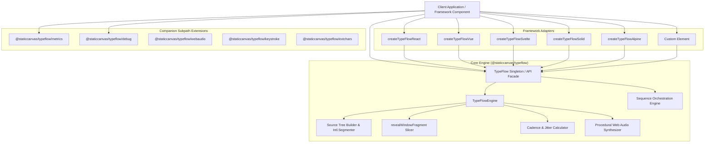

# TypeFlow Architecture Overview

TypeFlow is a zero-dependency, interruptible, framework-agnostic typewriter animation engine designed for modern web applications.

This directory serves as the canonical architectural reference for core maintainers and contributors.

---

## Architectural Principles

1. **Zero Dependencies**: Core animation algorithms, AST parser, and Web Audio synthesizers are implemented entirely in vanilla ES2022 without third-party runtime dependencies.
2. **Non-Destructive AST Windowing**: Text slicing operates over parsed DOM fragments (`revealWindowFragment`) and preserves semantic markup (`<code>`, `<strong>`, `<em>`, `<a>`, `<mark>`) without string concatenation or invalid HTML tag injection.
3. **Interruptible Lifecycle**: Every operation returns a `TypeFlowController` exposing a synchronous `stop()` method and an unresolved `Promise<TypeFlowResult>` that settles cleanly without uncaught rejections upon cancellation.
4. **Decoupled Extensions**: Performance metrics (`@staticcanvas/typeflow/metrics`), diagnostic tracing (`@staticcanvas/typeflow/debug`), procedural audio (`@staticcanvas/typeflow/webaudio`), keystroke modeling (`@staticcanvas/typeflow/keystroke`), and extended Unicode glyphsets (`@staticcanvas/typeflow/extchars`) are isolated in independent subpath exports to prevent bundle bloat.
5. **Zero Cumulative Layout Shift (CLS)**: The `TypeFlow.fit()` bounding box estimator and fixed-width constant spacing cursor prevent layout shifts during dynamic reveals.

---

## High-Level System Topology

---

## Directory Index

| Document | Focus Area | Key Concepts |
| :--- | :--- | :--- |
| [`core-engine.md`](file:///mnt/g/devspace/projects/web/_repo/staticcanvas/typeflow/architecture/core-engine.md) | Core reveal & erase pipeline | AST source trees, `Intl.Segmenter`, directional window slicing, 12 reveal styles, 8 erase styles, smart diff morphing. |
| [`extensions-and-plugins.md`](file:///mnt/g/devspace/projects/web/_repo/staticcanvas/typeflow/architecture/extensions-and-plugins.md) | Companion extensions | Metrics HUD, `@staticcanvas/logcad` tracing, extended Unicode glyphsets, keystroke physical dynamics. |
| [`framework-adapters.md`](file:///mnt/g/devspace/projects/web/_repo/staticcanvas/typeflow/architecture/framework-adapters.md) | Framework integration architecture | Injected runtime factories, lifecycle teardown, signal reactivity, custom elements. |
| [`state-and-performance.md`](file:///mnt/g/devspace/projects/web/_repo/staticcanvas/typeflow/architecture/state-and-performance.md) | Timing, memory & accessibility | WeakMap baselines, timer teardown, Web Audio node recycling, WCAG `aria-live`, `prefers-reduced-motion`. |
| [`documentation-system.md`](file:///mnt/g/devspace/projects/web/_repo/staticcanvas/typeflow/architecture/documentation-system.md) | Hugo docs site engineering | Zero-FOUC preload guard, View Transitions API, token design system, search indexing. |
