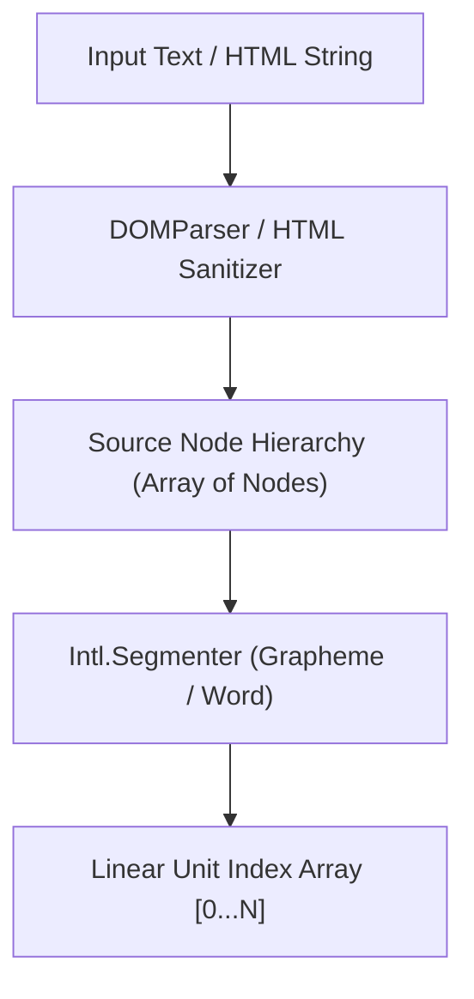
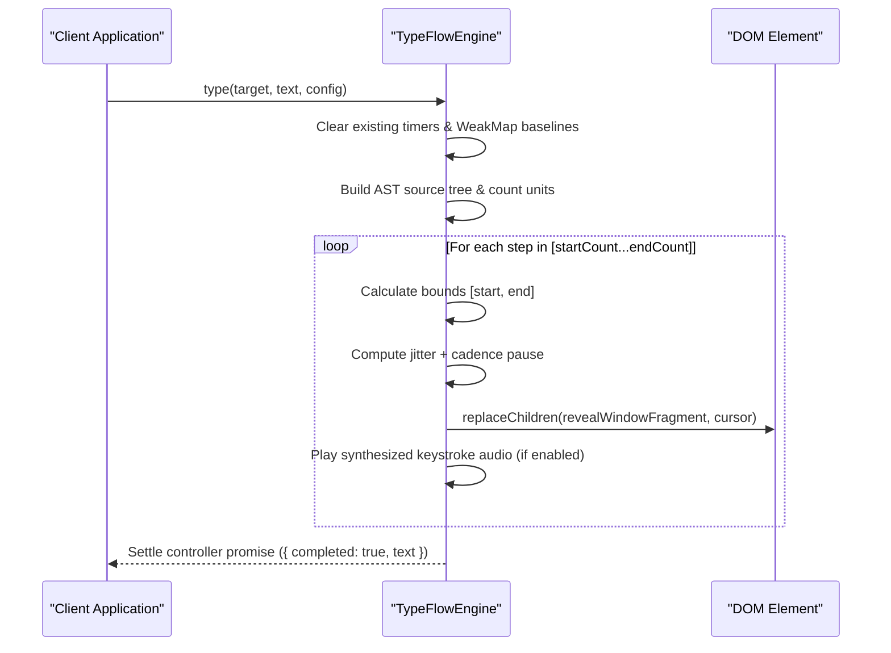

# Core Engine Architecture

The TypeFlow core engine orchestrates string and HTML typography transformations via AST node windowing and segmented timeline scheduling.

---

## 1. AST Source Tree Representation

When `TypeFlow.type()` receives input text or sanitized HTML markup, the engine constructs an in-memory normalized node hierarchy before scheduling any animation frames:



### Source Tree Node Schema

Each item in the `sourceTree` conforms to a discriminated union:

```typescript
type SourceTreeNode =
  | {
      type: 'text';
      units: string[];       // Segmented grapheme clusters or words
      rawText: string;       // Unmodified text content
    }
  | {
      type: 'element';
      tag: string;           // 'strong', 'em', 'code', 'a', 'mark', etc.
      attrs: Record<string, string>;
      children: SourceTreeNode[];
      unitCount: number;     // Aggregate unit count across child subtree
    };
```

---

## 2. Window Slicing Algorithm (`revealWindowFragment`)

Rather than mutating inner HTML string representations, TypeFlow executes a non-destructive interval slice:

$$\text{Visible Window} = [S, E] \quad \text{where} \quad 0 \le S \le E \le N$$

```javascript
function calculateWindowBounds(count, totalUnits, direction, eraseStyle, isErasing) {
  if (!isErasing) {
    if (direction === 'left') return { start: 0, end: count };
    if (direction === 'right') return { start: totalUnits - count, end: totalUnits };
    if (direction === 'center') {
      const half = count / 2;
      const mid = totalUnits / 2;
      return { start: Math.max(0, Math.floor(mid - half)), end: Math.min(totalUnits, Math.ceil(mid + half)) };
    }
  } else {
    if (eraseStyle === 'end') return { start: 0, end: count };
    if (eraseStyle === 'start') return { start: totalUnits - count, end: totalUnits };
    if (eraseStyle === 'center') {
      const half = count / 2;
      const mid = totalUnits / 2;
      return { start: Math.max(0, Math.floor(mid - half)), end: Math.min(totalUnits, Math.ceil(mid + half)) };
    }
  }
  return { start: 0, end: count };
}
```



---

## 3. Reveal & Erase Engines Matrix

| Style | Direction Vector | Math Formulation | Primary Use Case |
| :--- | :--- | :--- | :--- |
| **`char`** | Left-to-right, Right-to-left, Center-out | $\Delta c = 1$ unit per tick | Standard terminal and typewriter reveals. |
| **`word`** | Word boundary segmentation | $\text{Segmenter.segment}(\dots, \text{'word'})$ | Fast reading speeds and transcript teleprompters. |
| **`scramble`** | Matrix glyph substitution rounds | $r \in [1 \dots R]$ iterations per glyph | Cybernetic, decrypt, and high-tech UI headings. |
| **`fade-trail`** | Trailing character opacity gradient | $\alpha(i) = \alpha_{\min} + (1 - \alpha_{\min}) \cdot \frac{i}{L}$ | Refined editorial and luxury brand typography. |
| **`morph`** | Longest Common Prefix (LCP) | $\text{LCP}(A, B) \to \text{Erase Suffix} \to \text{Type Delta}$ | Dynamic state transitions and status badge updates. |
| **`stream`** | Chunked non-blocking FIFO queue | Asynchronous buffer ingestion | Real-time LLM token streams and WebSocket payloads. |

---

## 4. Cadence & Dynamic Jitter Engine

Humanized typing dynamics are simulated by computing contextual micro-pauses based on sentence syntax and punctuation markers:

```typescript
function calculateCadencePause(text: string, count: number): number {
  if (count <= 0 || count > text.length) return 0;
  const char = text[count - 1];
  if (char === '.' || char === '!' || char === '?') return 220; // Sentence termination
  if (char === ',' || char === ';' || char === ':') return 110; // Clause separation
  if (char === ' ') return 40;                                  // Word break
  return 0;
}
```

When `options.speedVariance` $> 0$, an equidistant random jitter factor is added:

$$\text{Delay}_{\text{step}} = \max\left(0, \text{speed} + \left(2 \cdot \text{random}() - 1\right) \cdot \text{speedVariance} + \text{cadencePause}\right)$$
