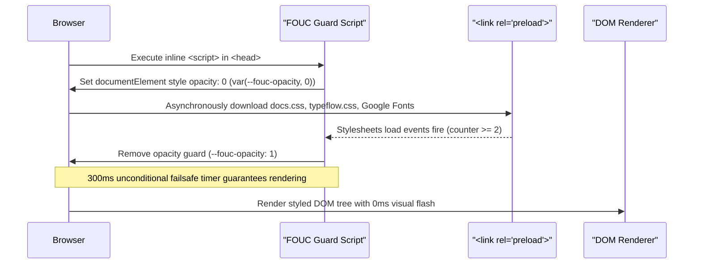
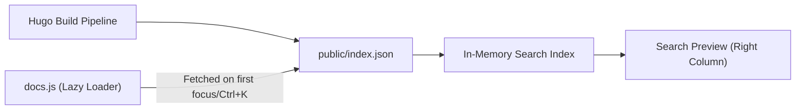

# Documentation System Architecture

The TypeFlow documentation portal is built on Hugo with a custom high-performance architecture emphasizing instant render performance, zero Flash of Unstyled Content (FOUC), View Transitions API navigation, and responsive accessibility.

---

## 1. Zero-FOUC & Critical Rendering Path

To eliminate styling flashes on initial page load, stylesheets are preloaded asynchronously while inline critical CSS renders the initial layout shell synchronously:



---

## 2. View Transitions API Navigation

Page navigation utilizes a two-tier View Transitions architecture:

1. **Cross-Document Opt-In**:
   ```css
   @view-transition {
     navigation: auto;
   }
   ```
2. **Same-Document Navigation Intercept**:
   Internal sidebar and TOC navigation clicks are intercepted in `docs.js` via `document.startViewTransition()` to smoothly slide page content (`.main-content`) without flickering sticky headers (`.site-header`) or the left rail (`.sidebar`).
3. **Reduced Motion Fallback**:
   When `prefers-reduced-motion: reduce` is active, transition animations are disabled instantly.

---

## 3. Search Indexing Pipeline

Hugo compiles an `index.json` static endpoint containing page metadata, descriptions, section headings (`##`, `###`), and raw content snippets.



The right-column search preview features real-time markdown parsing (code blocks, inline code, bold, italic, quotes, lists) and live TypeFlow typography animation at 2ms/char.
