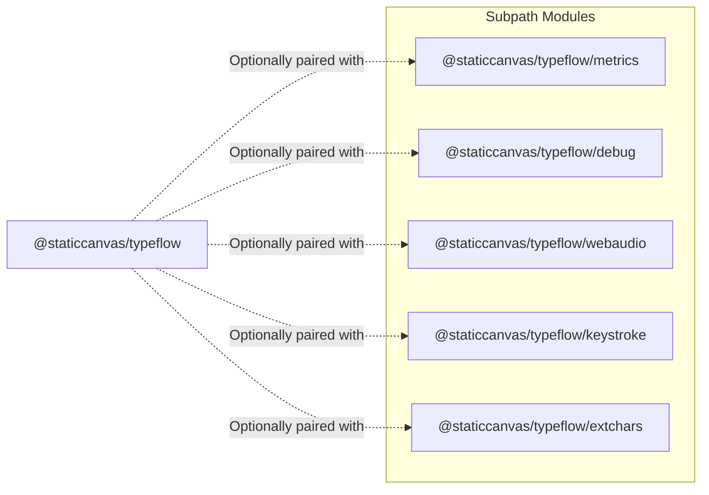
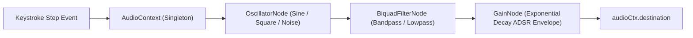

# Companion Extensions Architecture

TypeFlow separates secondary diagnostic and utility systems into isolated module entry points. This guarantees zero payload overhead for production applications that only require the core typewriter engine.

---

## Subpath Export Registry



---

## 1. `TypeFlowMetrics` (`@staticcanvas/typeflow/metrics`)

`TypeFlowMetrics` provides real-time performance telemetry and a floating diagnostic HUD.

### Telemetry Pipeline
1. **Frame Time Sampling**: Samples `requestAnimationFrame` intervals to measure render jitter and dropped frames.
2. **Animation Throughput**: Measures active animations, characters typed per second (CPS), and DOM mutation counts.
3. **Floating UI Renderer**: Mounts an isolated floating badge or expanded performance inspector without external CSS stylesheets.

```typescript
export interface TypeFlowMetricsStats {
  activeControllers: number;
  totalCharsTyped: number;
  totalCharsErased: number;
  averageCPS: number;
  currentCPS: number;
  droppedFrames: number;
  uptimeMs: number;
}
```

---

## 2. `TypeFlowDebug` (`@staticcanvas/typeflow/debug`)

`TypeFlowDebug` integrates with the `@staticcanvas/logcad` standard logging schema and browser devtools console.

### Diagnostic Tracing Capabilities
- **Lifecycle Hook Interception**: Emits structured log records on `start`, `step`, `pause`, `complete`, and `interrupt`.
- **Memory Leak Detection**: Audits uncollected controller baselines and dangling `setInterval` timers.
- **Export Schema**: Produces timestamped JSON traces for automated CI test assertions.

---

## 3. `TypeFlowWebAudio` (`@staticcanvas/typeflow/webaudio`)

Procedural audio generation utilizing the native browser `AudioContext` without network asset requests.



### Sound Profiles
- **`mechanical`**: Multi-stage transient noise burst mimicking a blue mechanical keyboard switch.
- **`beep`**: High-frequency teletype ping with rapid 15ms exponential decay.
- **`synth`**: Modulated cyber chirp with pitch drop down to 120Hz.

---

## 4. `TypeFlowKeystroke` (`@staticcanvas/typeflow/keystroke`)

Simulates human physical biomechanics, finger traveling distances on standard QWERTY layouts, and intentional typo injection with backspace self-correction.

---

## 5. `TypeFlowExtChars` (`@staticcanvas/typeflow/extchars`)

Supplies extended Unicode glyph sets for themed decrypt and scramble reveals, including:
- `hieroglyphs` (Egyptian Gardiner signs)
- `greek` (Classical Greek alphabet)
- `math` (Mathematical operators and set theory symbols)
- `chess` (Chess notation figures)
- `geometric` (Geometric glyphs and polygons)
- `astronomy` (Astronomical symbols)
- `currency` (Global monetary currency markers)
- `arrows` (Directional arrows)
