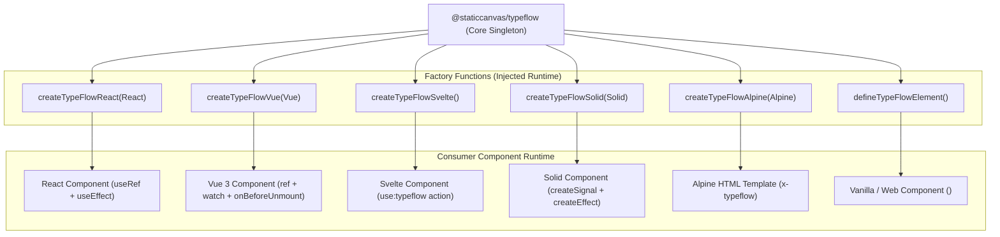

# Framework Adapters Architecture

TypeFlow utilizes runtime injection factories (`createTypeFlowReact`, `createTypeFlowVue`, `createTypeFlowSvelte`, `createTypeFlowSolid`, `createTypeFlowAlpine`, `defineTypeFlowElement`) to provide framework-specific hooks and directives without embedding framework dependencies in the library bundle.

---

## 1. Adapter Design Pattern

---

## 2. Teardown & Lifecycle Isolation

All adapters adhere to the following invariants:
1. **Unmount Cleanup**: Whenever a host component unmounts, the underlying `TypeFlowController.stop()` method is invoked synchronously to clear pending timers.
2. **Re-render Resilience**: When inputs or text props mutate, the active controller is stopped before initiating the replacement animation, preventing interleaved animation artifacts.
3. **WeakMap Preservation**: DOM baseline elements are managed in `TypeFlowEngine.baselines` WeakMaps to avoid memory leaks during dynamic component destruction.

---

## 3. Supported Ecosystem Implementations

| Framework | Implementation | Lifecycle Contract |
| :--- | :--- | :--- |
| **React** | `useTypeFlow(text, config)` | `useEffect(() => () => controller.stop(), [text])` |
| **Vue 3** | `useTypeFlow(() => ref.value, config)` | `watch` immediate + `onBeforeUnmount(() => controller.stop())` |
| **Svelte** | `use:typeflow={{ text, config }}` | Standard Svelte Action (`update`, `destroy`) |
| **Solid.js** | `useTypeFlow(signal, config)` | `createEffect` + `onCleanup(() => controller.stop())` |
| **Alpine.js** | `x-typeflow="{ text, config }"` | `Alpine.directive` + `cleanup(() => controller.stop())` |
| **Web Components** | `<type-flow text="..." speed="30">` | `connectedCallback()` + `disconnectedCallback()` + `attributeChangedCallback()` |
| **Angular** | Standalone Directive `[appTypeFlow]` | `ngOnChanges` + `ngOnDestroy` |
