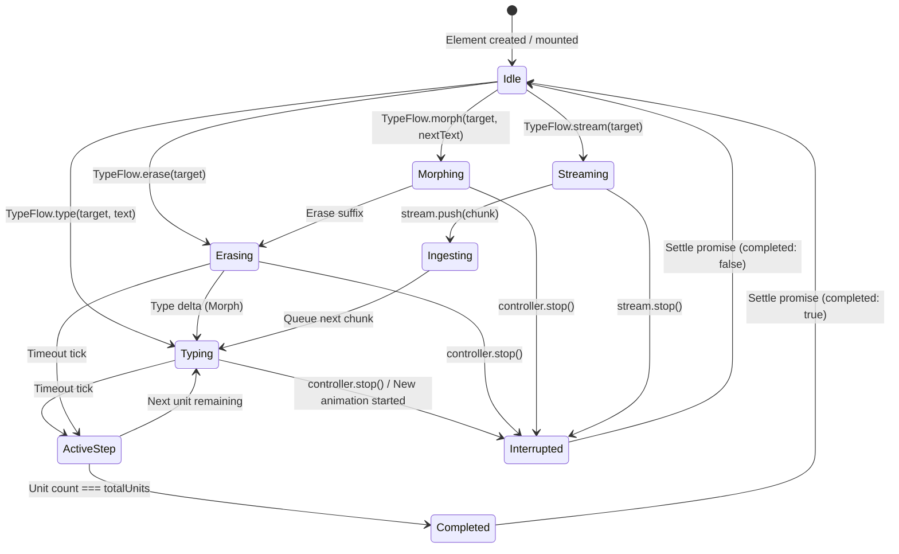

# State Management, Performance & Accessibility

This document outlines the state machine lifecycle, timer management, memory guarantees, and accessibility compliance rules for TypeFlow.

---

## 1. Animation State Machine

---

## 2. Memory & Timer Management

1. **Map & WeakMap Partitioning**:
   - `TypeFlowEngine.active`: `Map<Element, TypeFlowController>` tracking in-flight operations per element.
   - `TypeFlowEngine.baselines`: `WeakMap<Element, Node[]>` holding initial DOM nodes for `mode: 'append'`. Automatically garbage-collected when DOM elements are removed from memory.
   - `TypeFlowEngine.cursorIntervals`: `Map<Element, ReturnType<typeof setInterval>>` holding cursor blink timer references.
2. **Deterministic Teardown**:
   - Calling `TypeFlow.type()` on an element that is already animating stops the previous controller immediately before starting the new one.
   - Calling `TypeFlow.stop(target)` cancels all active timers, halts cursor blinking, and settles the promise with `{ completed: false, text }`.

---

## 3. Accessibility Standards (WCAG Compliance)

1. **`prefers-reduced-motion`**:
   - When `options.respectReducedMotion: true` (default), TypeFlow queries `window.matchMedia('(prefers-reduced-motion: reduce)')`.
   - If enabled, TypeFlow skips all animation frames and renders the final text state instantly without delay.
2. **`aria-live` Regions**:
   - By default, TypeFlow does not disrupt screen readers during character-by-character reveals.
   - Setting `ariaLive: 'polite' | 'assertive'` dynamically configures the container's `aria-live` attribute.
3. **Aria-Hidden Cursors**:
   - Cursor spans (`|`) are explicitly hidden from screen readers.
4. **Zero Layout Shift (CLS = 0)**:
   - Fixed-width cursor spacer (`\u00A0`) and inline dimension locking via `TypeFlow.fit()` guarantee that surrounding layout elements do not shift or reflow.
