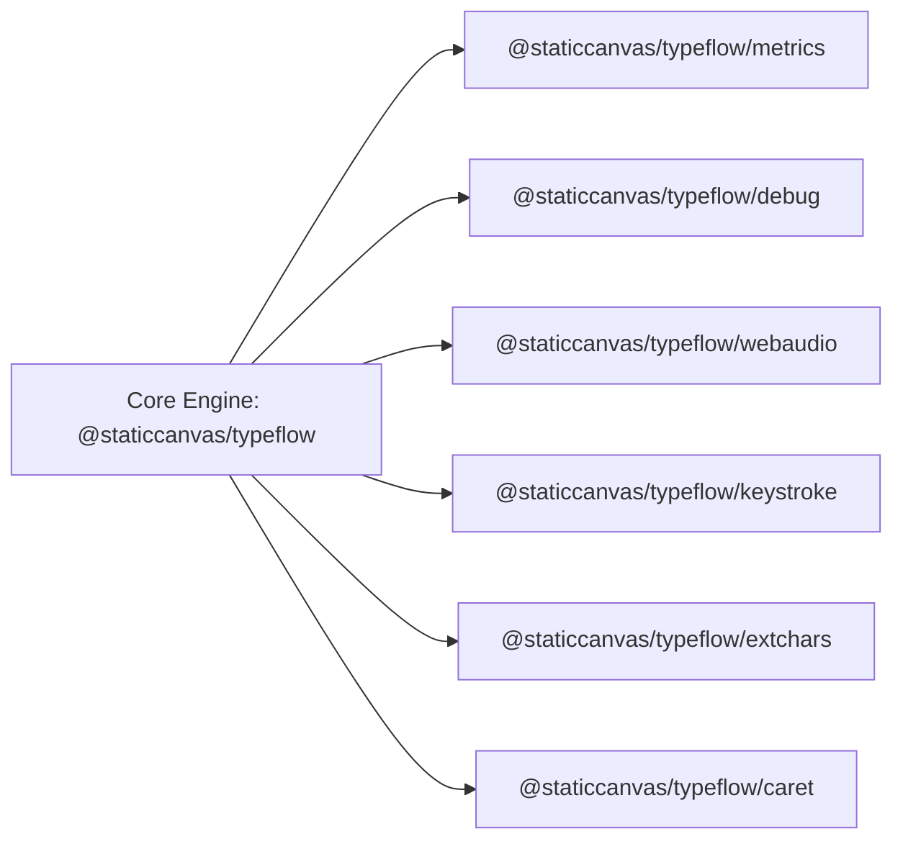

TypeFlow is built with a hyper-optimized core engine (<10 KB gzipped). For developers requiring advanced capabilities, TypeFlow provides six modular, tree-shakeable companion extensions.



---

## 1. Performance Metrics HUD (`@staticcanvas/typeflow/metrics`)

The `TypeFlowMetrics` extension mounts an accessible, zero-CLS floating diagnostic HUD badge in the viewport.

### Installation & Usage

```javascript
import { TypeFlowMetrics } from '@staticcanvas/typeflow/metrics';

// Mount floating badge in the bottom-right corner
const hud = TypeFlowMetrics.mount({
  position: 'bottom-right', // 'bottom-right' | 'bottom-left' | 'top-right' | 'top-left'
  detailed: false,          // Starts in compact mode; click to expand diagnostic cards
  updateInterval: 250,      // Polling frequency in ms
});

// Programmatic stats access
const stats = TypeFlowMetrics.getStats();
console.log('Active animations:', stats.activeInstances);
console.log('Lifetime characters typed:', stats.totalTyped);
```

### Metrics Tracked
- **Frame Rate (FPS)**: Real-time rendering frequency.
- **Active Animations**: Currently running TypeFlow controllers.
- **Lifetime Units**: Total typed and erased units.
- **DOM Mutations**: Count of DOM child / character modifications.
- **Heap Memory**: Current JS Heap memory (in supported browsers).
- **JSON Export**: One-click copy of telemetry data for bug reports.

---

## 2. Telemetry & LogCAD Debugging (`@staticcanvas/typeflow/debug`)

The `TypeFlowDebug` extension connects TypeFlow's animation lifecycle to `@staticcanvas/logcad` or styled console groups.

```javascript
import { TypeFlowDebug } from '@staticcanvas/typeflow/debug';
import { TypeFlow } from '@staticcanvas/typeflow';

// Enable debugging
TypeFlowDebug.enable({
  logcad: true,    // Route through @staticcanvas/logcad if available
  console: true,   // Output styled color-coded console logs
  maxHistory: 200, // Retain last 200 events in memory
});

// Trace a controller
const ctrl = TypeFlow.type('#headline', 'Diagnostics enabled');
TypeFlowDebug.trace(ctrl, 'Hero Headline');
```

---

## 3. Procedural Web Audio (`@staticcanvas/typeflow/webaudio`)

Synthesizes high-fidelity, zero-asset mechanical switch clicks, vintage teletype strikes, and cyber synths in real time using the native Web Audio API.

```javascript
import { TypeFlow } from '@staticcanvas/typeflow';
import { TypeFlowWebAudio, createKeystrokeAudio } from '@staticcanvas/typeflow/webaudio';

// Attach directly to TypeFlow's audio option
TypeFlow.type('#terminal', 'Connecting to mainframe...', {
  audio: createKeystrokeAudio('mechanical-blue', {
    pan: 0.2,            // Stereo pan (-1.0 to 1.0)
    pitchVariance: 0.06, // Natural ±6% frequency jitter
  }),
  speed: 35,
});
```

### Versioned sound presets

Built-ins are immutable schema-v1 records with separate type and erase action
envelopes. The extension validates oscillator, frequency, gain, duration,
filter, detune, and variance bounds before accepting a custom preset.

- `'mechanical-blue'` / `'clicky'`: Crisp high-transient click with body thud.
- `'mechanical-brown'` / `'tactile'`: Damped tactile bump.
- `'mechanical-red'` / `'mechanical'`: Smooth linear bottom-out.
- `'soft-keyboard'` / `'bubble'`: Filtered, quiet key response.
- `'typewriter'` / `'teletype'`: Electro-mechanical strike.
- `'synth'` / `'cyber-synth'`: Neon oscillator chirp.
- `'terminal-beep'` / `'terminal-8bit'` / `'beep'`: Retro square-wave pulse.
- `'correction'`: Distinct erase/correction feedback.

```javascript
import { AUDIO_PRESETS, TypeFlowWebAudio } from '@staticcanvas/typeflow/webaudio';

const custom = structuredClone(AUDIO_PRESETS['soft-keyboard']);
custom.actions.type[0].frequency.start = 640;

TypeFlowWebAudio.registerAudioPreset('product-soft', custom);
TypeFlowWebAudio.play('product-soft');
TypeFlowWebAudio.removeAudioPreset('product-soft');
```

The `AudioContext` is created only after browser user activation. The shared
master graph is reused and active voices are capped. A callback returned by
`createKeystrokeAudio()` owns a scoped voice set; interrupting its TypeFlow
controller automatically stops and disconnects that set without affecting
other callbacks. `stopAll()` and `destroy()` remain available for global
teardown. Use `action: 'erase'` to select a preset's correction envelope.

---

## 4. Humanized Keystroke Dynamics (`@staticcanvas/typeflow/keystroke`)

Simulates realistic human typing by modeling physical QWERTY finger travel distance, clause thought pauses, fatigue deceleration, and realistic typo injection with auto-correction backspaces.

```javascript
import { TypeFlowKeystroke, calculateKeyDistance } from '@staticcanvas/typeflow/keystroke';

// Calculate physical keyboard distance between keys
const dist = calculateKeyDistance('q', 'p'); // ~9.0 key units

// Compute dynamic delay for natural rhythm
const delay = TypeFlowKeystroke.getDelay('a', 'b', { baseSpeed: 40 });

// Injects realistic adjacent-key typos and automatic backspaces
const actions = TypeFlowKeystroke.humanize('Fast, resilient, zero dependencies.', {
  errorRate: 0.04,   // 4% typo probability per character
  hesitationMs: 180, // Pause before realizing mistake
});
```

---

## 5. Extended Unicode Charsets (`@staticcanvas/typeflow/extchars`)

Extends TypeFlow's scramble reveals with hundreds of specialized glyphs across ancient scripts, mathematics, and cyber glitch presets.

```javascript
import { TypeFlow } from '@staticcanvas/typeflow';
import { TypeFlowExtChars, getExtendedCharset } from '@staticcanvas/typeflow/extchars';

// Ancient Egyptian Hieroglyphic reveal
TypeFlow.type('#sacred-text', 'TEMPLE OF KARNAK', {
  typeStyle: 'scramble',
  scrambleGlyphs: getExtendedCharset('hieroglyphs'),
  scrambleRounds: 3,
});

// Combine multiple custom pools
const customPool = TypeFlowExtChars.combineCharsets('runic', 'katakana', 'mathSymbols');
```

### Available Extended Presets
- `hieroglyphs`: Egyptian hieroglyphic symbols (`𓀀𓀁𓀂𓀃...`).
- `runic`: Elder & Anglo-Saxon runes (`ᚠᚡᚢᚣᚤ...`).
- `ogham`: Celtic Ogham script (`ᚁᚂᚃᚄᚅ...`).
- `coptic`: Coptic alphabet (`ⲀⲂⲄⲆⲈ...`).
- `katakana`: Cyber Katakana glyphs (`ｱｲｳｴｵ...`).
- `boxDrawing`: Terminal borders & frames (`┌┐└┘├┤┬┴┼...`).
- `mathSymbols`: Calculus & set theory operators (`∀∂∃∅∆∇∈∉...`).
- `braille`: Full Braille patterns (`⠁⠂⠃⠄...`).
- `astronomical`: Planetary & zodiac glyphs (`☉☽☿♀♁♂...`).
- `glitch`: Combining zalgo diacritics.

---

## 6. Interactive Caret (`@staticcanvas/typeflow/caret`)

`TypeFlowCaret` is a persistent, editable cursor bound to an element's text. Unlike `TypeFlow.type()`/`erase()`, which run once from start to finish, a caret stays around: `jump()`/`move()` reposition it instantly, `deleteChar()`/`deleteWord()` edit at that position, and `insert()` types new text in with the usual character-by-character animation.

```javascript
import { Caret } from '@staticcanvas/typeflow/caret';

const caret = Caret('#terminal', { text: 'git commit -m "wip"' });

// Jump to just after "git ", delete the word "commit", type "push" in its place
caret.jump(4).deleteWord('forward').insert('push');
// "git push -m "wip""
```

It's a standalone, zero-dependency module — it does not import the core engine. If a page-global `TypeFlow` happens to be present, a caret opportunistically calls `TypeFlow.stop()` on its target before editing, so starting a caret edit interrupts any in-flight `type()`/`erase()` cleanly; the reverse (a `TypeFlow.type()` call interrupting an in-flight caret) is not automatic, since the two are otherwise fully decoupled.

### API

| Method | Description |
| :--- | :--- |
| `jump(position)` | Moves the caret to an absolute grapheme index, clamped to the text's bounds. |
| `move(delta)` | Moves the caret by a relative number of graphemes (positive = right, negative = left). |
| `deleteChar(direction)` | Deletes one grapheme: `'backward'` (Backspace, default) or `'forward'` (Delete). |
| `deleteWord(direction)` | Deletes the whitespace-delimited word adjacent to the caret, consuming the adjoining whitespace with it. |
| `insert(text, config)` | Types `text` at the caret position, shifting following content right. Returns `{ stop, promise }` like `TypeFlow.type()`. |
| `stop()` | Stops an in-flight `insert()`. |
| `destroy()` | Stops any in-flight `insert()` and clears the blink interval. |

`caret.text`, `caret.position`, and `caret.length` expose the current plain text, caret index, and total grapheme count. Every mutating method returns the caret instance, so calls can be chained.
