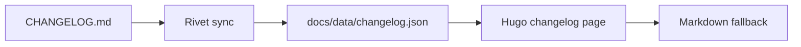

## Purpose

This page is a fixture, not a tutorial. Each fenced block below is rendered through the same Hugo/Chroma pipeline as the rest of the documentation, using the syntax color tokens defined in `docs.css` (`--tf-syntax-*`). Use it to check comment, keyword, declaration, type, function, property, variable, constant, string, number, operator, punctuation, tag, and attribute coverage for a given language in both themes.

## JavaScript

```javascript
// Comment: reveal a headline with a scramble-in effect
import { TypeFlow } from '@staticcanvas/typeflow';

const MAX_RETRIES = 3;
let attempts = 0;

class Announcer {
  constructor(target) {
    this.target = target;
  }

  async run(message) {
    const controller = TypeFlow.type(this.target, message, {
      typeStyle: 'scramble',
      speed: 32,
      cursor: '_',
    });
    return controller.promise;
  }
}

const announcer = new Announcer('#headline');
announcer.run(`Deploy complete: ${attempts}/${MAX_RETRIES}`);
```

## TypeScript

```typescript
// Comment: typed configuration for a reveal sequence
import type { TypeFlowConfig } from '@staticcanvas/typeflow';

interface ReleaseNote {
  version: string;
  breaking: boolean;
  count: number;
}

function formatNote(note: ReleaseNote): string {
  const suffix = note.breaking ? '!' : '';
  return `v${note.version}${suffix} (${note.count} changes)`;
}

const config: TypeFlowConfig = {
  speed: 28,
  cursor: '|',
  respectReducedMotion: true,
};

const note: ReleaseNote | null = null;
console.log(note ?? formatNote({ version: '0.28.0', breaking: false, count: 12 }));
```

## HTML

```html
<!-- Comment: playground target markup -->
<section class="pg-stage" data-mode="replace" aria-live="polite">
  <h2 id="headline">Release notes</h2>
  <p class="lede">Generated from <code>CHANGELOG.md</code>.</p>
  <a href="/guides/erase-styles/" rel="noopener">Erase styles guide</a>
</section>
```

## CSS

```css
/* Comment: token-driven card surface */
.matrix-card {
  --card-radius: 10px;
  display: flex;
  gap: var(--space-2);
  border: 1px solid var(--tf-border-default);
  border-radius: var(--card-radius);
  background: var(--tf-bg-surface);
  transition: transform 0.2s ease, box-shadow 0.2s ease;
}

.matrix-card:hover {
  transform: translateY(-2px);
  box-shadow: 0 10px 30px rgba(0, 0, 0, 0.35);
}
```

## JSON

```json
{
  "name": "@staticcanvas/typeflow",
  "version": "0.28.0",
  "private": false,
  "engines": {
    "node": ">=18"
  },
  "keywords": ["typewriter", "animation", "zero-dependency"],
  "homepage": null
}
```

## Bash

```bash
#!/usr/bin/env bash
# Comment: run the capacity benchmark suite
set -euo pipefail

SAMPLE_COUNT="${1:-25}"
echo "Running benchmark with ${SAMPLE_COUNT} samples..."

if ! node --expose-gc scripts/run-benchmark.mjs --samples "$SAMPLE_COUNT"; then
  echo "Benchmark failed" >&2
  exit 1
fi
```

## PowerShell

```powershell
# Comment: preview generated release documentation
[CmdletBinding()]
param(
    [switch]$Apply,
    [string]$FromTag
)

Set-StrictMode -Version Latest
$ErrorActionPreference = 'Stop'

$repositoryRoot = Split-Path -Parent $PSScriptRoot
$isDryRun = -not $Apply

Write-Host "Dry run: $isDryRun"
if ($null -eq $FromTag) {
    throw 'FromTag is required.'
}
```

## Mermaid


