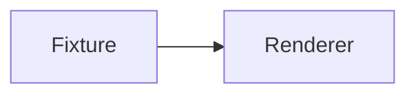

# Syntax highlighting fixtures

This file is test input and is not mounted into the Hugo documentation site.

```javascript
const ready = true;
export function start(value = 42) { return `run:${value}`; }
```

```typescript
interface Result { completed: boolean }
const result: Result | null = { completed: true };
```

```html
<button class="action" aria-pressed="false">Run</button>
```

```css
.action:hover { color: var(--tf-accent); transform: translateY(-1px); }
```

```json
{ "name": "typeflow", "enabled": true, "limit": 100 }
```

```bash
set -euo pipefail
npm run check:quality
```

```powershell
$ErrorActionPreference = 'Stop'
npm run check:quality
```


